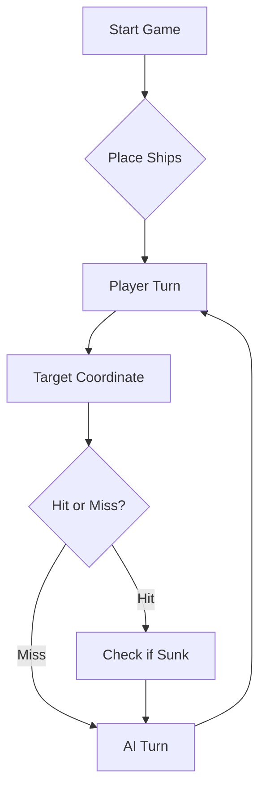

# ⚓ Battleship 2.0


> A modern take on the classic naval warfare game, designed for the XVII century setting with updated software engineering patterns.

---

## 📖 Table of Contents
- [Project Overview](#-project-overview)
- [Key Features](#-key-features)
- [Technical Stack](#-technical-stack)
- [Installation & Setup](#-installation--setup)
- [Code Architecture](#-code-architecture)
- [Roadmap](#-roadmap)
- [Contributing](#-contributing)

---

## 🎯 Project Overview
This project serves as a template and reference for students learning **Object-Oriented Programming (OOP)** and **Software Quality**. It simulates a battleship environment where players must strategically place ships and sink the enemy fleet.

### 🎮 The Rules
The game is played on a grid (typically 10x10). The coordinate system is defined as:

$$(x, y) \in \{0, \dots, 9\} \times \{0, \dots, 9\}$$

Hits are calculated based on the intersection of the shot vector and the ship's bounding box.

---

## ✨ Key Features
| Feature | Description | Status |
| :--- | :--- | :---: |
| **Grid System** | Flexible $N \times N$ board generation. | ✅ |
| **Ship Varieties** | Galleons, Frigates, and Brigantines (XVII Century theme). | ✅ |
| **AI Opponent** | Heuristic-based targeting system. | 🚧 |
| **Network Play** | Socket-based multiplayer. | ❌ |

---

## 🛠 Technical Stack
* **Language:** Java 17
* **Build Tool:** Maven / Gradle
* **Testing:** JUnit 5
* **Logging:** Log4j2

---

## 🚀 Installation & Setup

### Prerequisites
* JDK 17 or higher
* Git

### Step-by-Step
1. **Clone the repository:**
   ```bash
   git clone [https://github.com/britoeabreu/Battleship2.git](https://github.com/britoeabreu/Battleship2.git)
   ```
2. **Navigate to directory:**
   ```bash
   cd Battleship2
   ```
3. **Compile and Run:**
   ```bash
   javac Main.java && java Main
   ```

---

## 📚 Documentation

You can access the generated Javadoc here:

👉 [Battleship2 API Documentation](https://britoeabreu.github.io/Battleship2/)


### Core Logic
```java
public class Ship {
    private String name;
    private int size;
    private boolean isSunk;

    // TODO: Implement damage logic
    public void hit() {
        // Implementation here
    }
}
```

### Design Patterns Used:
- **Strategy Pattern:** For different AI difficulty levels.
- **Observer Pattern:** To update the UI when a ship is hit.
</details>

### Logic Flow


---

## 🗺 Roadmap
- [x] Basic grid implementation
- [x] Ship placement validation
- [ ] Add sound effects (SFX)
- [ ] Implement "Fog of War" mechanic
- [ ] **Multiplayer Integration** (High Priority)

---

## 🧪 Testing
We use high-coverage unit testing to ensure game stability. Run tests using:
```bash
mvn test
```

> [!TIP]
> Use the `-Dtest=ClassName` flag to run specific test suites during development.

---

## 🤝 Contributing
Contributions are what make the open-source community such an amazing place to learn, inspire, and create.

1. Fork the Project
2. Create your Feature Branch (`git checkout -b feature/AmazingFeature`)
3. Commit your Changes (`git commit -m 'Add some AmazingFeature'`)
4. Push to the Branch (`git push origin feature/AmazingFeature`)
5. Open a **Pull Request**

---

## Prompt Used to train the LLM (Google Gemini Pro)
The prompt we used was a modified version of the one given in the guide.

### Estratégia de Jogo — Oponente de IA

O teu objetivo é jogar Battleship de forma estratégica, afundando toda a frota inimiga no menor número possível de rajadas. Cada rajada deve conter exatamente 3 tiros, respeitando as regras do jogo e utilizando toda a informação disponível para melhorar as decisões seguintes.

#### 1. Diário de Bordo e Memória

- Mantém um Diário de Bordo com todas as rajadas disparadas, numeradas sequencialmente (Rajada 1, Rajada 2, etc.).
- Regista as coordenadas de cada tiro e o respetivo resultado, distinguindo água, navio atingido e navio afundado, incluindo o tipo e o tamanho do navio quando essa informação for disponibilizada.
- Mantém um registo atualizado das coordenadas já testadas, das posições dos navios parcialmente identificados e dos navios que ainda faltam afundar.
- Utiliza o histórico completo para orientar as decisões seguintes. Nunca ignores informação obtida em rajadas anteriores nem inventes resultados que não tenham sido comunicados pelo jogo.

#### 2. Validação dos Tiros

- Todos os tiros devem estar dentro dos limites do tabuleiro.
- Nunca dispares para coordenadas já testadas, exceto na última rajada, quando toda a frota inimiga já estiver afundada e for necessário completar os 3 tiros obrigatórios.
- Antes de cada rajada, valida as 3 coordenadas, garantindo que são válidas e distintas entre si.
- Se a frota inimiga já estiver totalmente afundada, utiliza os tiros restantes apenas para cumprir as regras da última rajada.

#### 3. Estratégia de Procura

- Quando não existirem navios atingidos por terminar, escolhe tiros que maximizem a probabilidade de encontrar navios ainda não identificados.
- Considera os tamanhos e as formas dos navios ainda por afundar, bem como as posições já confirmadas como água ou ocupadas.
- Aproveita a informação de tiros anteriores para excluir posições impossíveis e privilegiar zonas onde os navios ainda possam estar.
- Para navios que ocupam posições consecutivas na horizontal ou vertical, utiliza um padrão de procura que evite testar desnecessariamente todas as quadrículas.
- Distribui os 3 tiros de cada rajada de forma estratégica, evitando concentrá-los em zonas pouco promissoras sem justificação.

#### 4. Estratégia após Atingir um Navio

- Quando um tiro atingir um navio que ainda não esteja afundado, dá prioridade à descoberta das restantes posições dessa embarcação.
- Na jogada seguinte, considera as posições contíguas a norte, sul, este e oeste do impacto, excluindo as que já foram testadas ou que estejam fora do tabuleiro.
- Se existirem vários impactos no mesmo navio, utiliza-os para determinar a sua orientação e concentra os tiros nas posições ainda não testadas dessa linha.
- Se um navio já tiver sido atingido em posições alinhadas, privilegia a continuação nessa direção em vez de explorar direções incompatíveis com a informação obtida.
- Se houver mais do que um navio parcialmente identificado, dá prioridade às situações com maior probabilidade de permitir afundar uma embarcação rapidamente.

#### 5. Gestão dos Navios Afundados

- Quando o resultado de uma rajada confirmar que um navio foi afundado, identifica as posições exatas ocupadas por essa embarcação utilizando o Diário de Bordo e os resultados recebidos.
- Considera o tamanho e a forma do navio para confirmar a sua localização, sem assumir posições que não sejam sustentadas pela informação disponível.
- Como os navios não se podem tocar, marca como água todas as quadrículas adjacentes à embarcação, incluindo as diagonais, desde que essa regra seja garantida pelas regras do jogo.
- Não voltes a disparar para essas quadrículas.
- Atualiza a lista de navios ainda por afundar e adapta a estratégia de procura aos navios restantes.

#### 6. Adaptação e Eficiência

- Em cada rajada, utiliza toda a informação disponível para escolher os tiros com maior valor estratégico.
- Evita repetir padrões de tiro que já tenham produzido resultados pouco úteis quando existam alternativas mais promissoras.
- Não confundas uma posição provável com uma posição confirmada: distingue sempre factos conhecidos de hipóteses.
- Se uma estratégia deixar de ser adequada devido a novos resultados, adapta imediatamente as decisões seguintes.
- Cumpre sempre as regras do jogo, sem inventar tiros, resultados ou informações sobre a frota adversária.

#### 7. Condição de Vitória

- A vitória só é alcançada quando todos os navios da frota inimiga estiverem afundados, de acordo com os resultados confirmados pelo jogo.
- Se a tua própria frota for totalmente afundada, aceita a derrota.
- Se afundares toda a frota inimiga, declara a vitória e apresenta um breve resumo do resultado final.

**Princípio fundamental:** cada tiro deve ter uma justificação estratégica baseada no histórico, nas regras do jogo e na informação disponível. O objetivo é maximizar a probabilidade de vitória e minimizar o desperdício de tiros.

## 📄 License
Distributed under the MIT License. See `LICENSE` for more information.

---
**Maintained by:** [@britoeabreu](https://github.com/britoeabreu)  
*Created for the Software Engineering students at ISCTE-IUL.*
